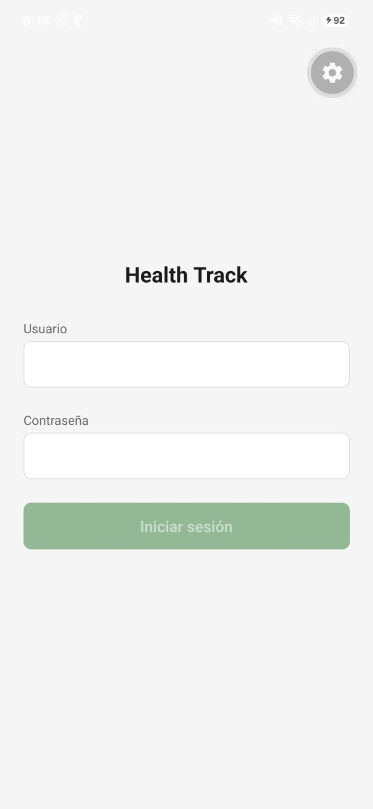
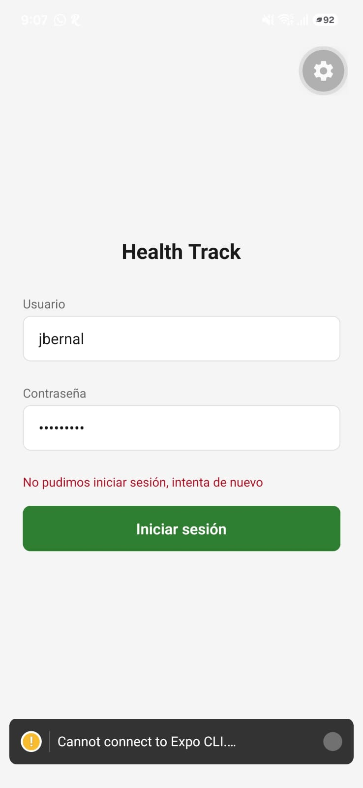
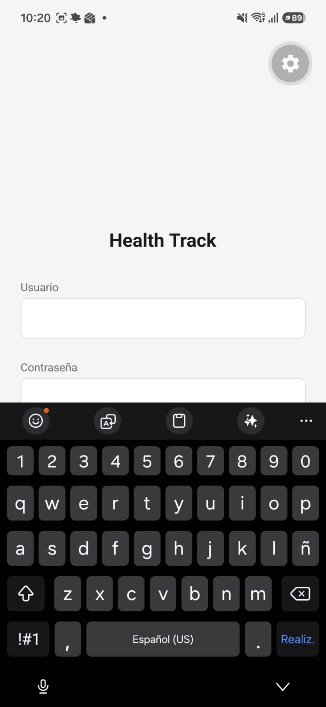
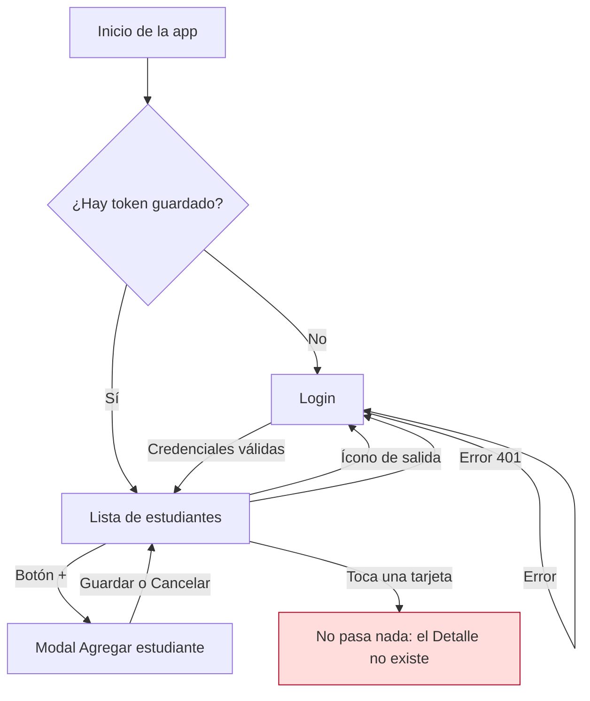

# Auditoría UX de mis pantallas

Pantallas auditadas: Login (HU6), Lista de estudiantes y Detalle de estudiante.
Base de la auditoría: la app de Health Track del equipo, importada sin cambios en el CP0.

## Capturas actuales

## Hallazgos

| Pantalla | Problema | Principio | Severidad | Arreglo propuesto |
| :--- | :--- | :--- | :--- | :--- |
| Login | La contraseña no se puede mostrar ni ocultar, solo se ve con puntos | Prevención de errores | Media | Botón "Mostrar" que alterne `secureTextEntry` |
| Login | El teclado tapa el botón "Iniciar sesión" (ver `before-login-keyboard.png`) | Diseño en pantalla pequeña | Alta | Envolver el formulario en `KeyboardAvoidingView` y `ScrollView` |
| Login | La tecla Enviar del teclado no inicia sesión | Eficiencia de uso | Baja | `returnKeyType="next"` en usuario y `returnKeyType="done"` con `onSubmitEditing` en contraseña |
| Login | Con el servidor caído sale el mensaje genérico "No pudimos iniciar sesión, intenta de nuevo", porque en `AuthContext` las dos ramas del ternario dan el mismo texto | Mensajes de error útiles | Media | Mensaje propio para `NetworkError`, por ejemplo "No pudimos conectar con el servidor" |
| Lista de estudiantes | Tocar una tarjeta no hace nada ni da respuesta visual, y para el lector de pantalla aparece como botón | Retroalimentación | Alta | Navegar al Detalle con el `id` del estudiante y agregar estilo de presionado |
| Lista de estudiantes | La tarjeta solo muestra `name`, aunque `Student` trae también `documentNumber` | Jerarquía visual | Media | Nombre en negrita y `documentNumber` debajo, en texto secundario |
| Lista de estudiantes | Al deslizar para recargar, la lista se reemplaza por el skeleton y `refreshing` está fijo en `false` | Estados de la interfaz | Media | Estado `refreshing` aparte, sin quitar la lista de la pantalla |
| Lista de estudiantes | Cerrar sesión con el ícono de salida se ejecuta con un solo toque, sin confirmación | Prevención de errores | Media | Alerta de confirmación antes de cerrar sesión y etiqueta de texto junto al ícono |
| Detalle de estudiante | La pantalla no existe, y el stack no tiene encabezado ni botón de regreso | Patrón de navegación | Alta | Crear `StudentDetail` en el stack con encabezado y botón de regreso, usando los datos de la lista porque el backend no tiene `GET /students/:id` |

## Mapa de navegación actual

Dónde se pierde el usuario:
- Al tocar una tarjeta de la lista no hay ninguna respuesta. El usuario espera ver el detalle del estudiante y se queda en la misma pantalla sin saber si falló o si la app está rota.
- El ícono de salida cierra la sesión de inmediato y lo devuelve al Login, sin avisar.
