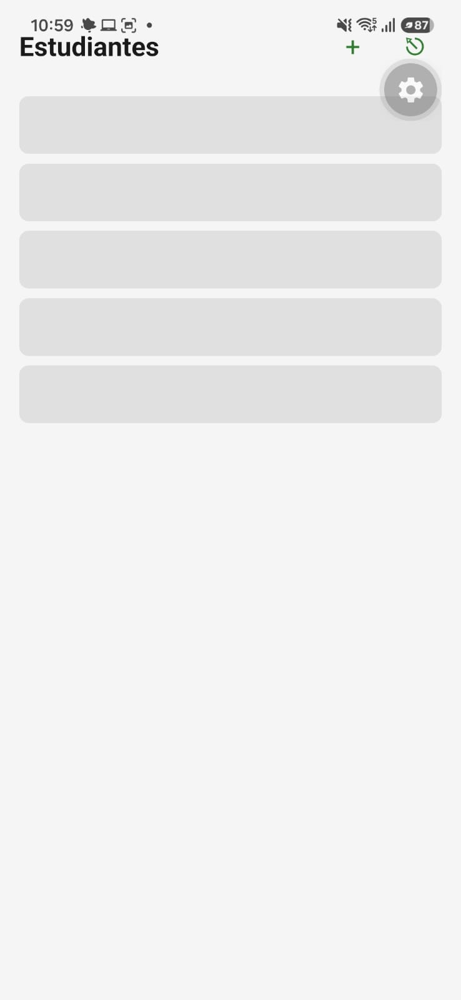
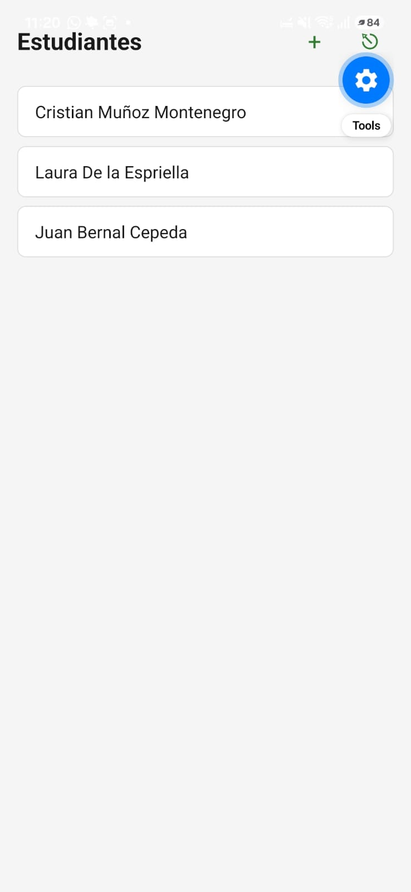
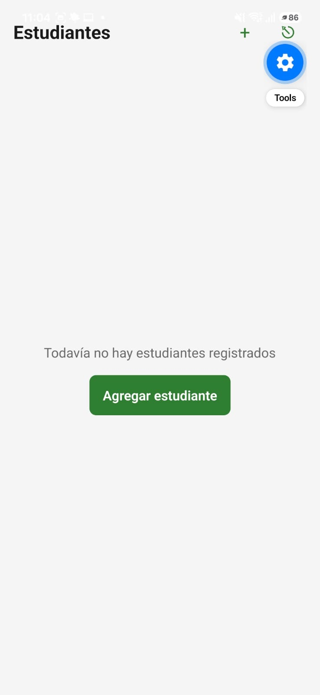
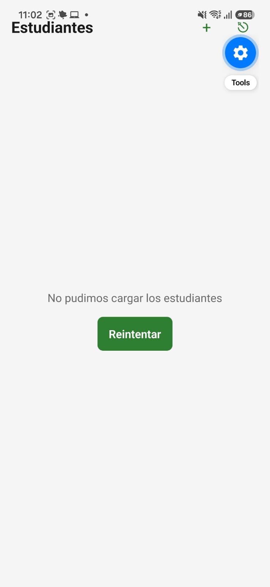

# Estados de la Lista de estudiantes

Pantalla: Lista de estudiantes (`StudentListScreen`), que carga los datos de `GET /students`.

## Cómo se fuerza cada estado

Los estados se fuerzan con variables de entorno que lee `StudentRepositoryImpl.getStudents`. Se ponen en la terminal y se reinicia Expo con `npx expo start -c`. Después de cada prueba se limpian con `Remove-Item Env:EXPO_PUBLIC_SIM_DELAY_MS, Env:EXPO_PUBLIC_SIM_LIST -ErrorAction SilentlyContinue`.

| Estado | Cómo se fuerza | Captura |
| :--- | :--- | :--- |
| Cargando | `$env:EXPO_PUBLIC_SIM_DELAY_MS = "8000"` retrasa la respuesta 8 segundos |  |
| Con datos | Sin variables, con el backend corriendo y 3 estudiantes creados |  |
| Vacío | `$env:EXPO_PUBLIC_SIM_LIST = "empty"` |  |
| Error | `$env:EXPO_PUBLIC_SIM_LIST = "error"` |  |

## Qué muestra cada estado

- **Cargando:** cinco barras grises con la forma de `StudentCard`, con la etiqueta accesible "Cargando estudiantes".
- **Con datos:** una tarjeta por estudiante. Al deslizar hacia abajo se recarga con `RefreshControl` y la lista no desaparece mientras tanto.
- **Vacío:** el mensaje "Todavía no hay estudiantes registrados" y el botón "Agregar estudiante".
- **Error:** el mensaje "No pudimos cargar los estudiantes" y el botón "Reintentar", que vuelve a pedir los datos.

## Prueba automatizada

`npm test` ejecuta `StudentListScreen.test.tsx`. Simula una falla al cargar y comprueba que se muestra el mensaje de error. Luego presiona "Reintentar" y comprueba que se pidieron los estudiantes por segunda vez y que ya aparece "Laura De la Espriella".