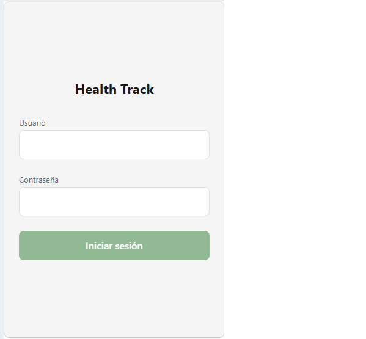
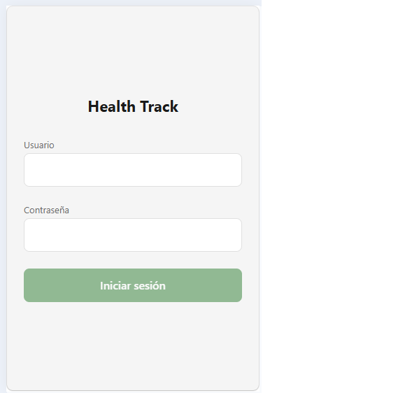

# Accesibilidad y diseño responsivo

Pantalla auditada con Lighthouse: Login. La Lista de estudiantes no se pudo auditar en el navegador, porque pide sesión y el backend no tiene CORS habilitado para peticiones desde la web.

## Puntaje de Lighthouse (Accesibilidad, móvil)

| Antes | Después |
| :--- | :--- |
| on una alerta que el lector de pantalla anuncia (`accessibilityRole="alert"` y `accessibilityLiveRegion="polite"`). | lían: los botones solo con ícono (`+` y salir) tienen `accessibilityLabel`, las áreas táctiles miden al menos 44 px (los botones y campos tienen `minHeight: 48`) y los tamaños de letra escalan con la configuración del teléfono. |

Lighthouse no detecta varios de los problemas que corregí, así que el puntaje no cambia mucho.

## Lo que corregí

- **Login:** el error de inicio de sesión y el aviso "Sin conexión" ahora s- **Login:** la tecla Enviar del teclado inicia sesión, con 
eturnKeyType="done" y onSubmitEditing en el campo de contraseña. Antes no hacía nada.
- **Login:** los dos campos tienen utoComplete (username y password) para que el teléfono ofrezca las credenciales guardadas.
- **Login, responsivo:** el formulario tiene ancho máximo de 480 y se centra. A 768 px ya no se estira de lado a lado.
- **Lista de estudiantes:** cada tarjeta tiene una indicación para el lector de pantalla, "Abre el detalle del estudiante", porque ahora lleva al detalle.

Revisé también estos puntos y ya cump
## Capturas

| Ancho | Antes | Después |
| :--- | :--- | :--- |
| 360 px |  |  |
| 768 px |  |  |