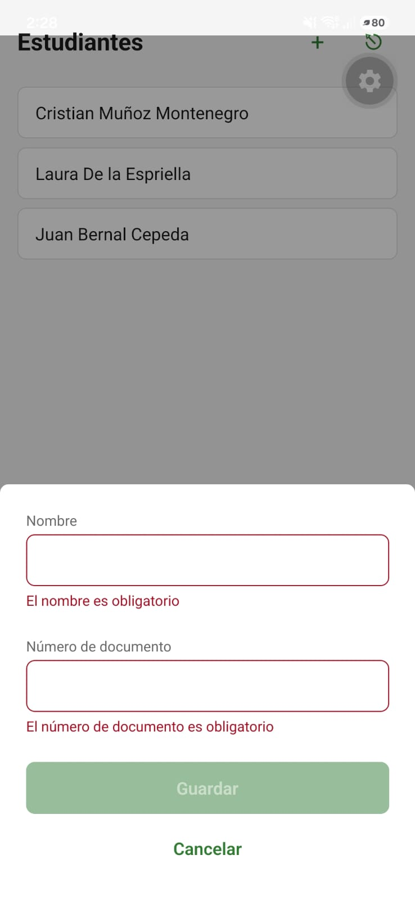
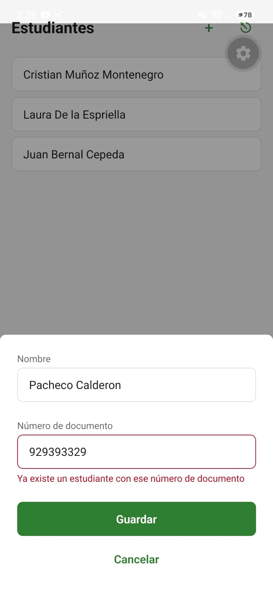
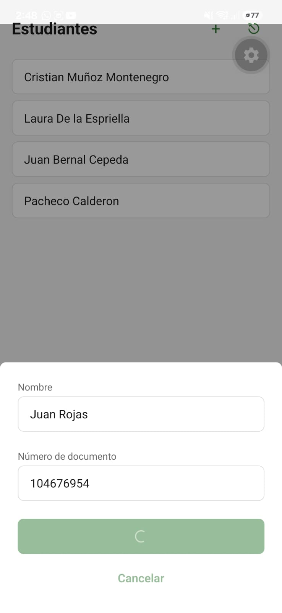
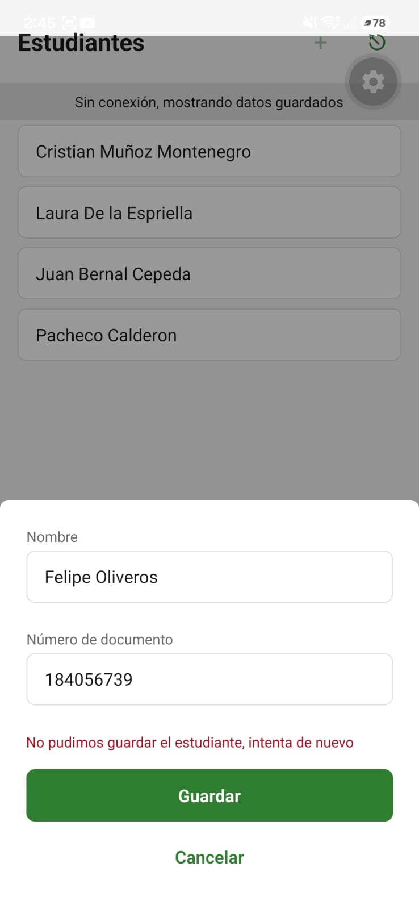
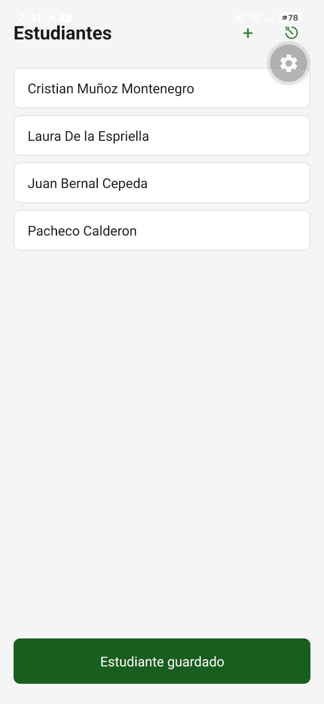
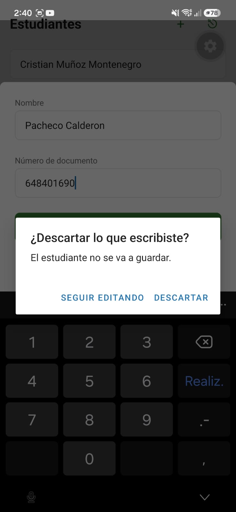
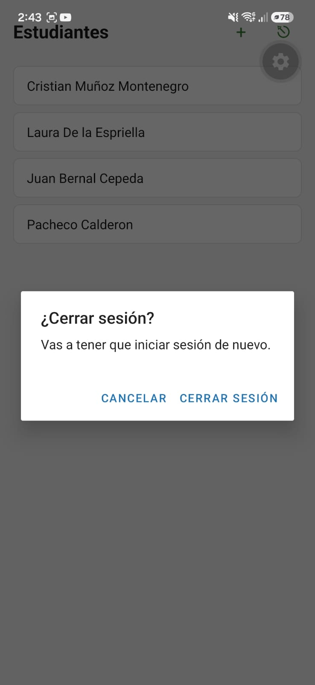

# Formulario "Agregar estudiante" con validación y retroalimentación

Formulario elegido: el modal "Agregar estudiante" de la Lista de estudiantes (`AddStudentModal`), que crea un `Student` con `name` y `documentNumber` mediante `POST /students`.

## Reglas de validación de cada campo

| Campo | Regla | Por qué existe en el dominio | Dónde se valida |
| :--- | :--- | :--- | :--- |
| `name` | Obligatorio; los espacios solos no cuentan como texto | `data-model.md` (entidad Student) pide que `name` no esté vacío después de quitar espacios. La Lista de estudiantes muestra solo el nombre en cada tarjeta, así que una tarjeta sin nombre no se podría identificar | App (`validateName`) y servidor |
| `documentNumber` | Obligatorio; los espacios solos no cuentan como texto | `data-model.md` exige que no esté vacío después de quitar espacios. Es lo que identifica a cada estudiante | App (`validateDocumentNumber`) y servidor |
| `documentNumber` | Único entre todos los estudiantes | `data-model.md` define el documento como único (`Student_documentNumber_key`, historia HU5-CA2) | Servidor, que responde 409; la app muestra el aviso bajo el campo |
| `name` y `documentNumber` | Se envían sin espacios al inicio ni al final | `data-model.md` indica que se guardan recortados | App (`trim()` al enviar) |

No agregué reglas de formato ni de largo para `documentNumber`, porque `data-model.md` dice expresamente que en la v1.0.0 no existen: acepta cualquier texto no vacío. El teclado numérico del campo es solo una comodidad para el entrenador, no una regla.

## Comportamiento del formulario

- El mensaje de error sale debajo del campo cuando el usuario sale de él sin llenarlo, no mientras escribe.
- El botón "Guardar" queda deshabilitado mientras haya un campo con error o mientras se envía.
- Mientras se envía, "Guardar" muestra un indicador de carga y los campos se bloquean.
- Si el servidor responde 409, el aviso "Ya existe un estudiante con ese número de documento" aparece bajo el campo del documento. Se quita al volver a escribir.
- Si falla otra cosa, por ejemplo el servidor caído, sale un mensaje general dentro del modal y se conserva lo escrito para reintentar sin volver a digitarlo.
- Si se guarda bien, el modal se cierra, la lista se actualiza sin ocultarse y aparece el mensaje verde "Estudiante guardado" durante 3 segundos.
- Acciones que pierden algo piden confirmación con una ventana: cancelar el modal cuando ya hay texto escrito y cerrar sesión, porque borra la sesión y los datos guardados.

## Capturas de los estados

| Estado | Captura |
| :--- | :--- |
| Campo vacío con error y "Guardar" deshabilitado |  |
| Documento duplicado |  |
| Enviando (indicador de carga) |  |
| Error del servidor |  |
| Éxito: mensaje verde en la lista |  |
| Confirmación al cancelar con texto escrito |  |
| Confirmación al cerrar sesión |  |

## Cómo se forzó cada estado

- **Error de campo:** abrir el modal, tocar un campo y salir de él sin escribir.
- **Duplicado:** guardar con un `documentNumber` que ya existe.
- **Cargando:** `$env:EXPO_PUBLIC_SIM_DELAY_MS = "8000"` y reiniciar Expo con `npx expo start -c`.
- **Error del servidor:** apagar el backend y tocar "Guardar".

## Diferencia con la documentación del equipo

`screens/student-list.md` dice que en la v1.0.0 un documento duplicado muestra el mismo error general que cualquier otro fallo, y que el mensaje propio llegaría después con el código `STUDENT_DOCUMENT_DUPLICATE`, que el backend todavía no envía. Para mostrarlo ya en el campo, la app distingue el duplicado por el código de estado HTTP 409 y no por el texto del error. Queda como propuesta para el equipo.