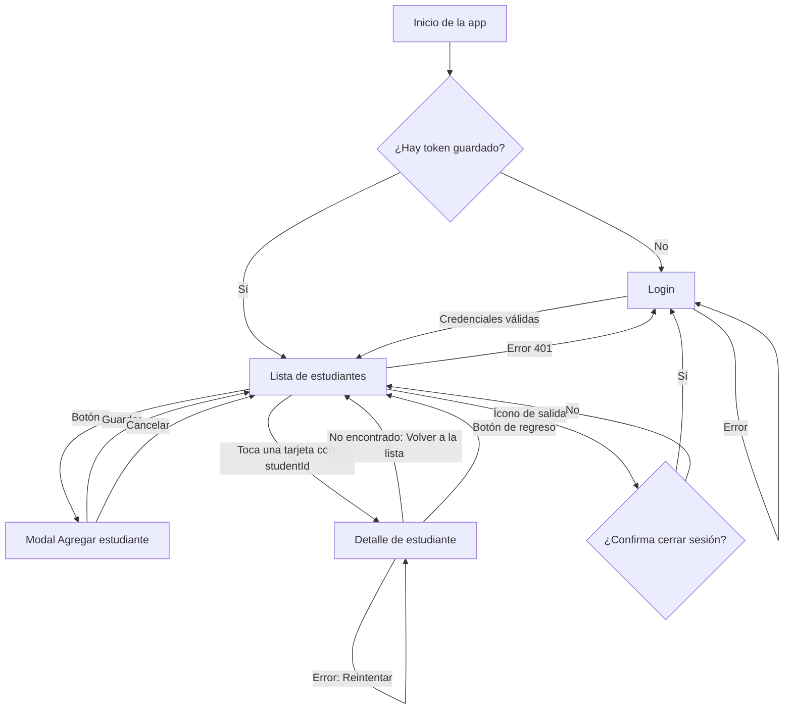
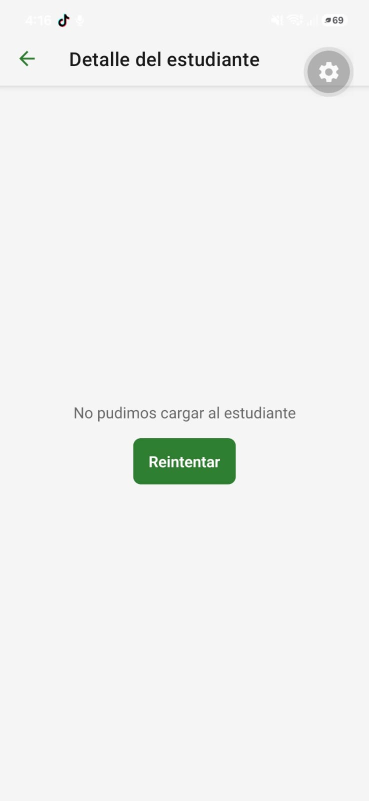
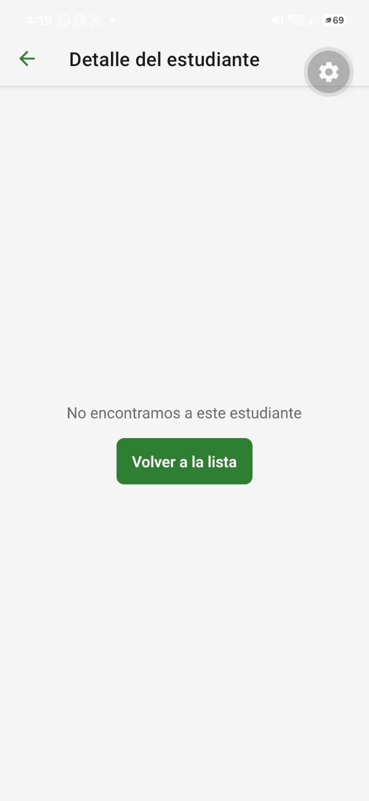

# Flujo de navegación completo

## Mapa actual (con la pantalla de detalle)

## Comparación con el mapa del CP1

| | Mapa del CP1 | Mapa actual |
| :--- | :--- | :--- |
| Tocar una tarjeta de la lista | No pasaba nada: el usuario se quedaba sin saber si la app falló | Abre el Detalle del estudiante |
| Ver el `documentNumber` de un estudiante | Imposible: la tarjeta solo mostraba el nombre | Un toque en la tarjeta |
| Volver a la lista desde el detalle | No existía | Un toque en el botón de regreso del encabezado |
| Cerrar sesión | Un toque y la sesión se cerraba | Dos toques: el ícono y la confirmación |

Qué le ahorra al usuario: quitamos el callejón sin salida de la lista. Antes, para consultar los datos de un estudiante no había ningún camino. Ahora llega con un toque y vuelve con otro, sin depender de adivinar. El cierre de sesión ahora cuesta un toque más a propósito, para que un toque accidental no borre la sesión y los datos guardados.

## Cómo se llega al Detalle

La ruta `StudentDetail` recibe el parámetro `studentId`, que la Lista de estudiantes envía al tocar una tarjeta (`navigate("StudentDetail", { studentId: item.id })`). La pantalla no recibe el estudiante completo: lo busca con el caso de uso `GetStudentById`.

El backend todavía no tiene `GET /students/:id` (E-04 en `api-contract.md`), así que `getStudentById` busca el `id` dentro de la lista que ya existe, con la copia guardada como respaldo cuando no hay conexión. Cuando el equipo agregue E-04, solo cambia ese método del repositorio.

## Estados del Detalle

| Estado | Cómo se forzó | Captura |
| :--- | :--- | :--- |
| Con datos | Sin variables |  |
| Cargando | `$env:EXPO_PUBLIC_SIM_DELAY_MS = "8000"` |  |
| Error | `$env:EXPO_PUBLIC_SIM_DETAIL = "error"` |  |
| No encontrado | `$env:EXPO_PUBLIC_SIM_DETAIL = "notfound"` |  |

Después de cada prueba se limpian las variables y se reinicia Expo con `npx expo start -c`. No hay estado vacío porque solo se llega al detalle desde una tarjeta que existe. El estado "no encontrado" cubre el caso en que el `id` ya no esté en los datos.