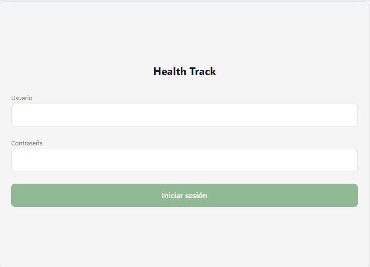
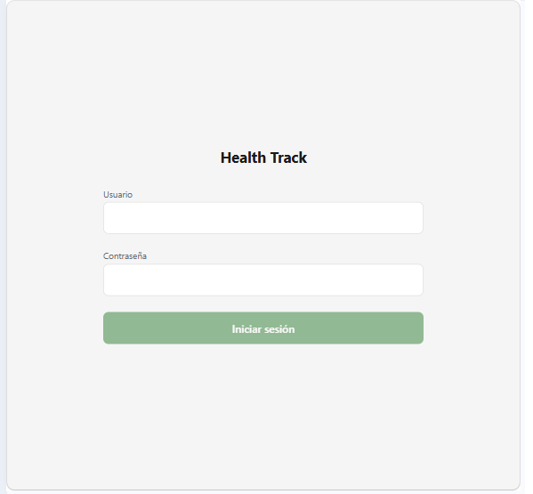
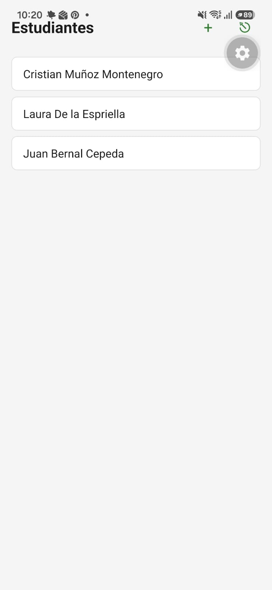
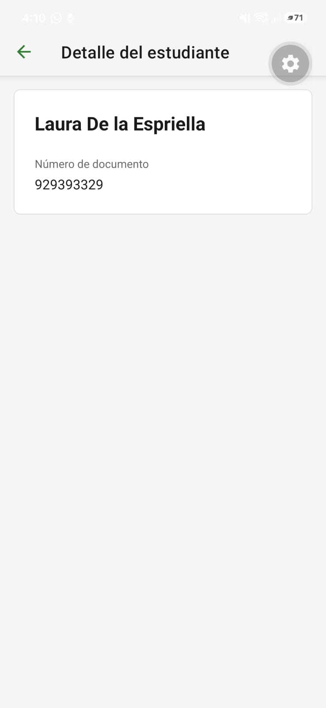

# Antes y después

## Login

| Antes (768 px) | Después (768 px) |
| :--- | :--- |
|  |  |

**Qué cambió:** el formulario ya no se estira de lado a lado en una pantalla ancha: queda centrado con un ancho máximo de 480. **Principio:** diseño responsivo.

Otros cambios del Login que no se ven en una captura: el mensaje de error y el de sin conexión ahora se anuncian a un lector de pantalla (accesibilidad), la tecla Enviar del teclado inicia sesión (eficiencia de uso) y los campos tienen autocompletado de usuario y contraseña.

## Lista de estudiantes

| Antes | Después |
| :--- | :--- |
|  |  |

**Qué cambió:** los botones del encabezado pasaron de ser solo íconos, `+` y de salir, a tener texto visible: "+ Agregar" y "Salir". Cerrar sesión además pide confirmación. **Principios:** reconocimiento antes que recuerdo, y prevención de errores. El cambio salió de la prueba de usabilidad del CP8, donde las dos personas tuvieron que adivinar para qué servía el `+`.

La lista también ganó sus tres estados (cargando, vacío y error con "Reintentar") y recarga deslizando sin ocultarse. Están documentados en `03-states.md`.

## Detalle de estudiante

| Antes | Después |
| :--- | :--- |
|  |  |

**Qué cambió:** antes, tocar una tarjeta no hacía nada. Ahora abre el detalle del estudiante, con su nombre y su número de documento, y un botón de regreso. **Principios:** patrón de navegación (de la lista a un detalle en una pila) y retroalimentación de cada acción. El detalle tiene sus cuatro estados, documentados en `07-navigation-flow.md`.

## Historias de usuario para el backlog del equipo

### Historia 1: botones del encabezado con texto visible

**Como** entrenador, **quiero** ver los botones de agregar y cerrar sesión con texto, **para** no confundirlos ni tener que adivinar cuál es cuál.

Criterios de aceptación:
- El encabezado de la Lista de estudiantes muestra los textos "+ Agregar" y "Salir", además de su ícono.
- El nombre accesible de cada botón coincide con el texto que se ve.
- A 360 px de ancho los dos botones y el título "Estudiantes" caben sin cortarse.
- Al tocar "Salir" aparece la ventana "¿Cerrar sesión?" con las opciones "Cancelar" y "Cerrar sesión", y la sesión solo se cierra si se confirma.
- Una segunda prueba con dos personas completa la tarea de registrar un estudiante sin errores.

### Historia 2: detalle de un estudiante

**Como** entrenador, **quiero** abrir un estudiante desde la lista, **para** consultar su número de documento.

Criterios de aceptación:
- Tocar una tarjeta abre `StudentDetail` con el `studentId` en la ruta.
- La pantalla muestra el nombre y el `documentNumber` del estudiante, y el botón de regreso vuelve a la lista.
- Mientras carga muestra una barra gris; si falla muestra "No pudimos cargar al estudiante" con "Reintentar"; si el `id` no existe muestra "No encontramos a este estudiante" con "Volver a la lista".
- El backend expone `GET /students/:id` (E-04 de `api-contract.md`): responde 200 con `id`, `name` y `documentNumber` si existe, y 404 con `STUDENT_NOT_FOUND` si no.
- Con el endpoint disponible, la app deja de buscar el estudiante en la lista y lo pide por su `id`.

### Historia 3: formulario de agregar estudiante con avisos en el campo

**Como** entrenador, **quiero** que el formulario me avise en el campo cuando algo está mal, **para** corregirlo sin perder lo que escribí.

Criterios de aceptación:
- Si `name` o `documentNumber` quedan vacíos o con solo espacios, al salir del campo aparece debajo "El nombre es obligatorio" o "El número de documento es obligatorio".
- El botón "Guardar" está deshabilitado mientras haya un campo con error o mientras se envía.
- Con un `documentNumber` que ya existe, el servidor responde 409 y aparece bajo el campo "Ya existe un estudiante con ese número de documento".
- Al guardar con éxito el modal se cierra, la lista se actualiza sin ocultarse y aparece "Estudiante guardado" durante 3 segundos.
- Si el usuario cancela con texto escrito, aparece "¿Descartar lo que escribiste?" con "Seguir editando" y "Descartar".