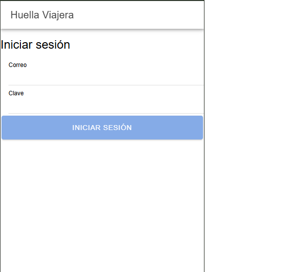
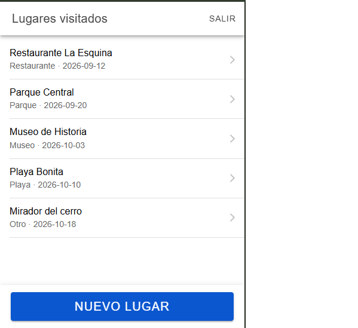
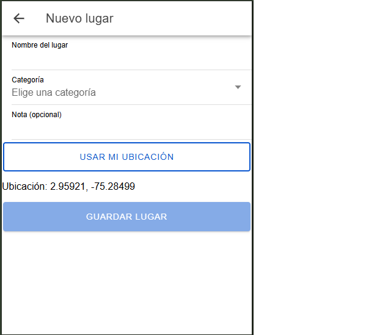
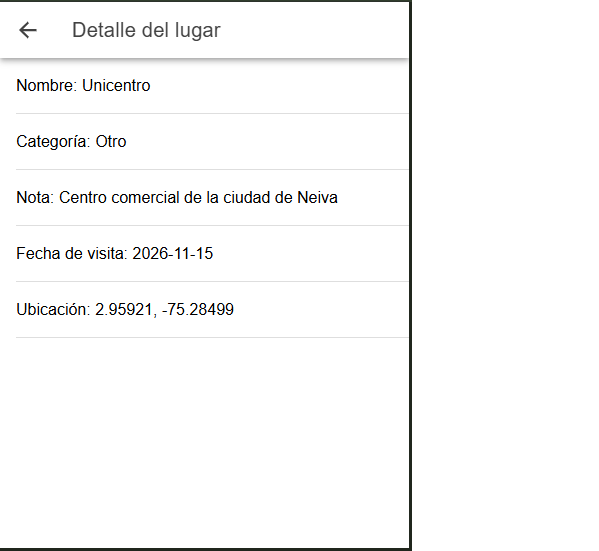
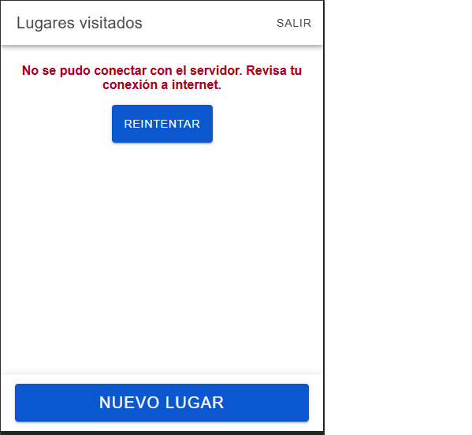
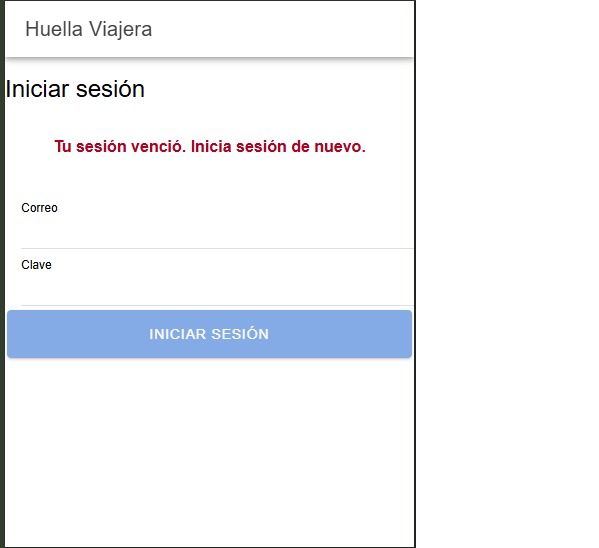
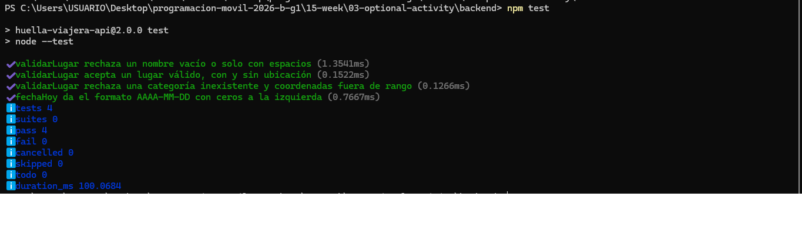

# Huella Viajera — Avance del proyecto final (Semana 15)

App móvil para guardar los lugares que visito, con una nota y la ubicación exacta del GPS.

## El problema

Cuando visito un lugar (un restaurante, un parque, una playa) casi nunca guardo dónde fue ni qué me pareció, y con el tiempo se me olvida. Quiero una app sencilla donde registrar los sitios que visito, con una nota y su ubicación, para encontrarlos y recordarlos después.

## La solución: el MVP

**Huella Viajera** permite iniciar sesión, ver la lista de lugares guardados, registrar un lugar nuevo y abrir el detalle de cada uno.

**Flujo principal, de punta a punta:**

1. Iniciar sesión con correo y clave.
2. Ver la lista **"Lugares visitados"**.
3. Tocar **"Nuevo lugar"**: escribir el nombre, elegir una categoría, agregar una nota opcional y tocar **"Usar mi ubicación"** para tomar la latitud y la longitud con el GPS.
4. Guardar el lugar: aparece en la lista, con la fecha de hoy.
5. Tocar un lugar de la lista para ver su detalle, incluida la ubicación.

## Qué incluye el MVP

| Requisito de la guía | Dónde está |
|---|---|
| Flujo de punta a punta (pantallas, navegación y estado) | `frontend/src/pages/`: `Login`, `Home`, `NuevoLugar`, `Detalle` |
| Conectividad con una API (carga y error) | `frontend/src/services/lugaresApi.ts`, que se comunica con `backend/` |
| Plugin nativo | GPS con `@capacitor/geolocation` (`frontend/src/services/ubicacion.ts`) |
| Almacenamiento local | El token de sesión se guarda con `@capacitor/preferences` (`frontend/src/services/sesion.ts`) |
| Calidad | Estados de carga, datos, error y vacío; 4 pruebas unitarias en `backend/test/` |

## Pantallas y navegación

```
Login ──(iniciar sesión)──▶ Lugares visitados ──[Nuevo lugar]──▶ Nuevo lugar ──(guardar o atrás)──▶ Lugares visitados
                                    │
                                    ├──[tocar un lugar]──▶ Detalle del lugar ──(atrás)──▶ Lugares visitados
                                    └──[Salir]──▶ Login
```

## Modelo de datos

Cada **lugar** tiene:

| Campo | Descripción |
|---|---|
| `id` | Número que asigna la API |
| `nombre` | Obligatorio |
| `categoria` | Restaurante, Parque, Museo, Playa u Otro |
| `nota` | Opcional |
| `fecha` | La pone la API con el día de hoy |
| `latitud`, `longitud` | Opcionales; vienen del GPS |

## Tecnologías y por qué se eligieron

| Tecnología | Para qué se usa | Por qué |
|---|---|---|
| **Ionic React + TypeScript** | La app (frontend) | Es el énfasis del curso, da una sola base de código y se puede probar en el navegador sin emulador. TypeScript avisa de errores de tipos mientras se programa |
| **Capacitor** | Llevar la app web a Android y acceder al hardware | Es el puente oficial de Ionic para usar el GPS y el almacenamiento del dispositivo |
| **Capacitor Geolocation** | GPS | Una app de lugares necesita la ubicación; el plugin también maneja el permiso y el caso en que el usuario lo niega |
| **Capacitor Preferences** | Guardar el token de sesión | Almacenamiento local simple, propio de la app en el celular |
| **Node.js + Express** | La API (backend) | Es sencillo montar una API REST con JSON, y usa el mismo lenguaje que el frontend |
| **JWT (jsonwebtoken)** | Login con token | La API valida el token en cada petición sin guardar sesiones en el servidor |
| **node:test** | Pruebas unitarias | Viene con Node, no requiere instalar nada más |

## Arquitectura

```
App (pantallas + estado)
   ↓  servicio lugaresApi.ts (fetch, token, errores)
API Express (login con JWT + rutas protegidas)  ↔  Datos de los lugares (en memoria)
   ↑  plugins: Geolocation (GPS) y Preferences (token)
```

Las pantallas nunca usan `fetch` directamente: todo pasa por `lugaresApi.ts`.

## API

| Método | Ruta | Protegida | Qué hace |
|---|---|---|---|
| POST | `/login` | No | Recibe `correo` y `clave`; devuelve un token que dura 1 hora |
| GET | `/lugares` | Sí | Lista los lugares |
| GET | `/lugares/:id` | Sí | Devuelve un lugar |
| POST | `/lugares` | Sí | Guarda un lugar nuevo (`nombre` y `categoria` obligatorios) |

Las rutas protegidas exigen la cabecera `Authorization: Bearer <token>`.

## Manejo de errores y calidad

- **Estados de la lista:** cargando, con datos, error (con botón "Reintentar") y vacío.
- **Errores de conexión:** el servicio distingue entre falta de red (mensaje y "Reintentar", sin cerrar la sesión), sesión vencida o token inválido con **401** (borra el token y lleva al login con un aviso) y errores del servidor (muestra el mensaje de la API).
- **GPS:** si el usuario niega el permiso de ubicación, aparece un mensaje y el lugar se puede guardar igual, sin ubicación.
- **Rendimiento:** la lista se guarda en memoria durante 1 minuto para no repetir peticiones a la API.
- **Accesibilidad:** colores con buen contraste y botones de al menos 48 px.
- **Pruebas:** 4 pruebas unitarias de las validaciones de la API (`npm test` dentro de `backend`).

## Cómo ejecutarlo

**Backend** (terminal 1):

```bash
cd backend
npm install
npm start
```

**Frontend** (terminal 2):

```bash
cd frontend
npm install
npm install @capacitor/core@8.6.0 @capacitor/cli@8.6.0 @capacitor/android@8.6.0 @capacitor/geolocation@8.2.4 @capacitor/preferences@8.0.1
ionic serve
```

Se abre en `http://localhost:8100`. **Usuario de prueba:** `viajero@huella.com` / `1234`.

**Pruebas:** `npm test` dentro de `backend`.

Los pasos para correr la app en un celular Android están en `12-week/03-optional-activity/README.md`.

## Capturas

| Pantalla | Captura |
|---|---|
| Inicio de sesión | `capturas/01-login.png` |
| Lista de lugares | `capturas/02-lista.png` |
| Nuevo lugar con la ubicación del GPS | `capturas/03-nuevo-lugar-ubicacion.png` |
| Detalle del lugar | `capturas/04-detalle.png` |
| Error por falta de red | `capturas/05-sin-red.png` |
| Sesión vencida (401) | `capturas/06-sesion-vencida.png` |
| Pruebas unitarias | `capturas/07-pruebas-unitarias.png` |









## Límites y próximos pasos

- Los lugares viven en la memoria de la API y se pierden al reiniciarla; el siguiente paso es una base de datos.
- Hay un solo usuario de prueba, fijo en el código; faltaría el registro de usuarios.
- El token se guarda con Preferences, que no cifra los datos (y en el navegador usa `localStorage`); una app publicada debería usar un almacenamiento cifrado.
- Todavía no hay modo sin conexión (caché persistente y cola de cambios), ni editar o eliminar lugares, ni filtrar por categoría.

## Entrega

```bash
git add .
git commit -m "Entrega semana 15"
git push
```
