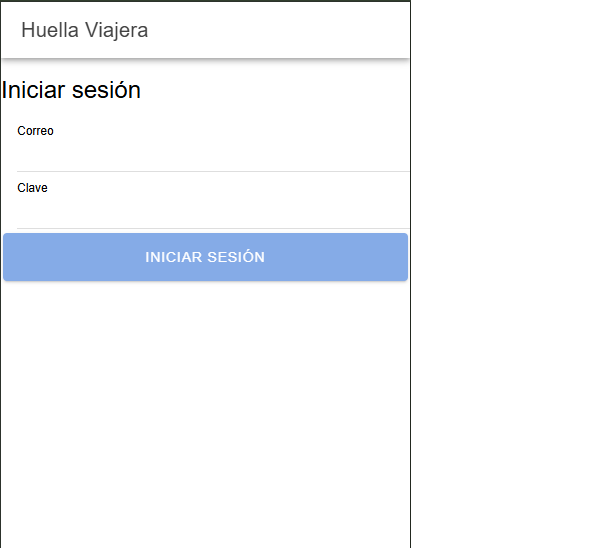
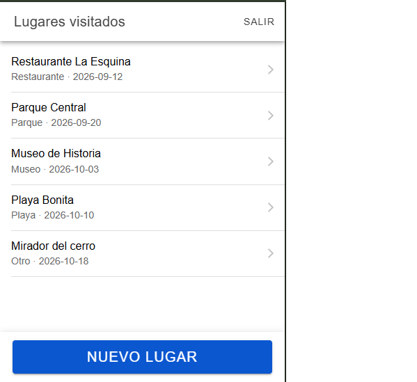
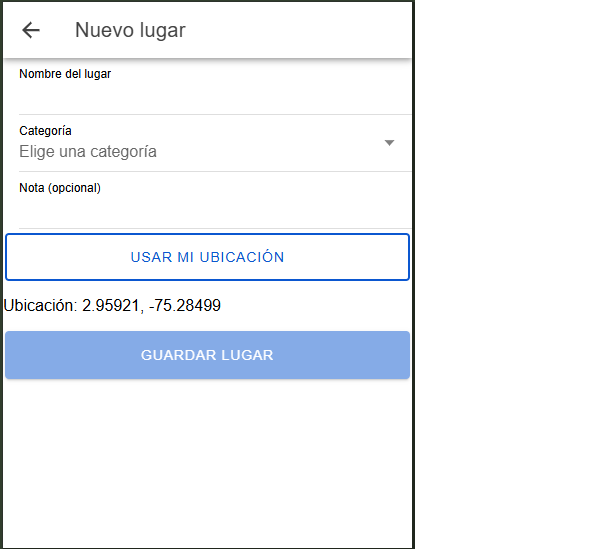
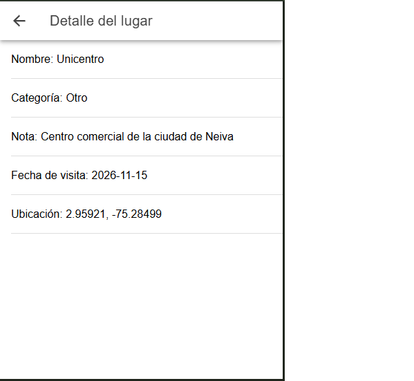
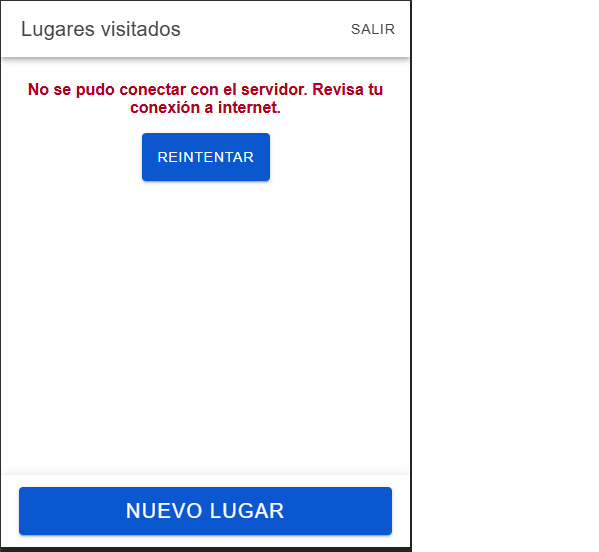
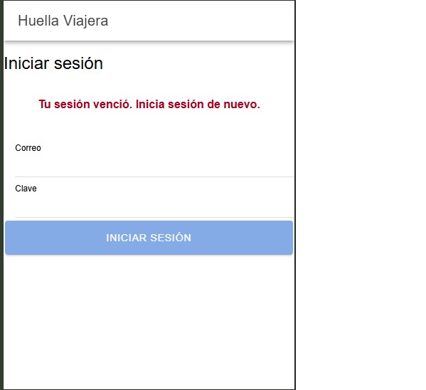
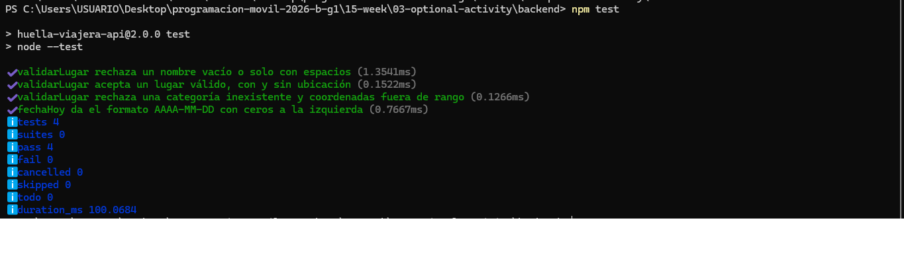

# Huella Viajera — Entrada de portafolio y plan de despliegue

App móvil para guardar los lugares que visito, con una nota y la ubicación exacta del GPS.

## Resumen

Huella Viajera nació de un problema simple: cuando visito un restaurante, un parque o una playa, casi nunca guardo dónde fue ni qué me pareció. La app permite iniciar sesión, registrar un lugar (nombre, categoría, nota y ubicación tomada con el GPS), verlo en una lista y abrir su detalle. Está hecha con Ionic React y una API en Node y Express, y se construyó semana a semana a lo largo del curso de Programación Móvil.

## Qué hace la app

1. **Inicio de sesión** con correo y clave. La API entrega un token (JWT) que dura 1 hora.
2. **Lista "Lugares visitados"**, con estados de carga, datos, error y vacío.
3. **Nuevo lugar:** nombre, categoría (Restaurante, Parque, Museo, Playa u Otro), nota opcional y el botón **"Usar mi ubicación"**, que pide el permiso del GPS y guarda la latitud y la longitud.
4. **Detalle** del lugar, con su fecha y su ubicación.
5. **Manejo de errores:** distingue entre falta de red (con "Reintentar"), sesión vencida (401, lleva al login) y errores del servidor.

## Capturas

| Pantalla | Captura |
|---|---|
| Inicio de sesión | `capturas/01-login.png` |
| Lista de lugares | `capturas/02-lista.png` |
| Nuevo lugar con la ubicación del GPS | `capturas/03-nuevo-lugar-ubicacion.png` |
| Detalle del lugar | `capturas/04-detalle.png` |
| Error por falta de red | `capturas/05-sin-red.png` |
| Sesión vencida (401) | `capturas/06-sesion-vencida.png` |
| Pruebas unitarias | `capturas/07-pruebas-unitarias.png` |









## Tecnologías

| Tecnología | Para qué |
|---|---|
| Ionic React + TypeScript | La app: una sola base de código, probable en el navegador |
| Capacitor (Geolocation y Preferences) | GPS y almacenamiento del token en el dispositivo |
| Node.js + Express | API REST |
| JWT (jsonwebtoken) | Login con token, sin sesiones en el servidor |
| node:test | Pruebas unitarias de las validaciones |

## Decisiones técnicas y retos

- **Un servicio único para la API.** Las pantallas nunca usan `fetch`: todo pasa por `lugaresApi.ts`, que pone el token y traduce los errores a tres tipos (sin red, sesión y servidor). Así cada pantalla reacciona igual ante el mismo error.
- **Ionic 9 y React Router 6.** El código que escribí al principio usaba funciones de la versión anterior del enrutador (`useHistory`, `Redirect`) y la pantalla quedó en blanco. Aprendí a leer el error de la consola y la guía de migración oficial en vez de adivinar.
- **Versiones de Capacitor.** Los paquetes de Capacitor deben tener la misma versión; cuando no la tienen, npm da un error de dependencias. La solución fue instalarlos juntos y con la misma versión, sin forzar la instalación.
- **GPS y permisos.** El permiso se pide distinto en el navegador y en el celular, y por eso el código maneja ambos casos y también el caso en que el usuario lo niega.
- **Medir antes de optimizar.** La lista se guarda en memoria durante 1 minuto para no repetir peticiones; la API imprime cada petición que recibe y así se pueden contar.

## Retroalimentación aplicada

Al revisar el proyecto para el cierre identifiqué estos puntos y los implementé en el código:

| Hallazgo | Cambio | Dónde |
|---|---|---|
| Al guardar un lugar, la app volvía a la lista sin avisar nada | Ahora muestra el aviso **"Lugar guardado"** | `frontend/src/pages/NuevoLugar.tsx` |
| Las fechas se veían como `2026-10-18`, difíciles de leer (y de escuchar con un lector de pantalla) | Ahora se muestran como **"18 de octubre de 2026"** | `frontend/src/services/formato.ts`, usada en la lista y en el detalle |
| Quedaba un componente de ejemplo sin usar | Se eliminó `ExploreContainer` | `frontend/src/components/` |
| El README no explicaba cómo se publica la app | Se agregó la sección de despliegue de abajo | este archivo |

Pendiente de la misma revisión: el identificador y el nombre de la app siguen siendo los del proyecto de ejemplo (`io.ionic.starter` y `app`) y hay que cambiarlos antes de publicar (ver el paso 2 del despliegue).

## Proceso de despliegue

### Estado actual

| Paso | Estado |
|---|---|
| Compilar la web | Probado en la Semana 12 con `npm run build`; no se repitió con esta versión |
| Proyecto Android y permisos de ubicación | Hechos en la Semana 12 (ver `12-week/03-optional-activity/README.md`); no se generaron de nuevo en esta carpeta |
| Nombre e identificador propios de la app | Pendiente |
| Paquete firmado (AAB) con una llave propia | Pendiente |
| Cuenta de desarrollador de Google Play | Pendiente |
| API publicada en un servidor con HTTPS | Pendiente |
| Política de privacidad en una dirección pública | Pendiente |
| Ícono propio y gráficos de la ficha de la tienda | Pendiente |
| Prueba cerrada con testers (obligatoria en cuentas personales nuevas) | Pendiente |

### Pasos para publicar

**1. Compilar la web.** Desde `frontend`:

```bash
ionic build
```

Genera la carpeta `dist` con la app lista para empaquetar.

**2. Crear el proyecto nativo y sincronizarlo.** Antes, en `capacitor.config.ts`, cambiar `appId` (hoy `io.ionic.starter`) y `appName` (hoy `app`) por valores propios, por ejemplo `com.huellaviajera.app` y `Huella Viajera`. El identificador no se puede cambiar después de publicar.

```bash
npx cap add android
npx cap sync
```

**3. Permisos.** En `android/app/src/main/AndroidManifest.xml` solo se deben declarar los que la app usa (en la Semana 12 se declararon estos):

| Permiso | Para qué | Justificación para la tienda |
|---|---|---|
| `INTERNET` | Hablar con la API | Necesario para iniciar sesión y guardar lugares |
| `ACCESS_COARSE_LOCATION` y `ACCESS_FINE_LOCATION` | GPS | Solo se piden cuando el usuario toca "Usar mi ubicación", y se guardan junto al lugar |

**4. Versión.** En `android/app/build.gradle`, `versionCode` (número entero que debe subir en cada actualización) y `versionName` (el texto que ve el usuario, por ejemplo `1.0`). También hay que comprobar en `android/variables.gradle` que `targetSdkVersion` cumpla el requisito actual de la tienda.

**5. Generar el paquete firmado.** En Android Studio: **Build, Generate Signed App Bundle / APK, Android App Bundle**. Se crea una llave de firma (keystore) **fuera del repositorio**, porque quien la tenga puede publicar actualizaciones de la app, y nunca se sube a GitHub. El resultado es un archivo `.aab`.

**6. Probar el paquete de lanzamiento en un celular real** antes de subirlo.

**7. Publicar.** En Google Play Console: crear la app, completar la ficha, subir el `.aab` primero a una prueba cerrada y, cuando se cumplan los requisitos, a producción.

### Requisitos de Google Play (revisados en noviembre de 2026)

- Cuenta de desarrollador de Google Play: pago único de 25 USD y verificación de identidad.
- Las apps nuevas se publican como **Android App Bundle (.aab)**, no como APK.
- Desde el 31 de agosto de 2026, las apps nuevas y sus actualizaciones deben apuntar a **Android 16 (API 36)** o superior.
- Las cuentas personales creadas después del 13 de noviembre de 2023 deben hacer una **prueba cerrada con al menos 12 testers durante 14 días seguidos** antes de pedir el acceso a producción.
- Política de privacidad pública, formulario de seguridad de los datos y cuestionario de clasificación de contenido.

Estos datos vienen de guías sobre Google Play de 2026 y pueden cambiar; la fuente oficial es la ayuda de Play Console.

### Ficha de la tienda (borrador)

| Campo | Contenido |
|---|---|
| Nombre (máx. 30 caracteres) | Huella Viajera |
| Descripción corta (máx. 80 caracteres) | Guarda los lugares que visitas con una nota y su ubicación GPS. |
| Descripción larga | Huella Viajera te ayuda a recordar los sitios que visitas. Registra el nombre, la categoría, una nota y la ubicación exacta de cada lugar, y consúltalos cuando quieras. |
| Categoría | Viajes y guías locales |
| Ícono | PNG de 512 × 512 píxeles (pendiente) |
| Gráfico destacado | 1024 × 500 píxeles (pendiente) |
| Capturas | Al menos 2 de teléfono (se pueden usar las de este README) |
| Política de privacidad | Dirección pública, obligatoria porque la app usa la ubicación y el correo (pendiente) |
| Seguridad de los datos | Declarar ubicación (precisa y aproximada) y correo; los datos se envían al servidor de la app |

### Qué impide publicar hoy

- La API corre en mi computador y la app se conecta por HTTP; una app publicada necesita una API en un servidor con **HTTPS**, y quitar las excepciones de HTTP que se usan para las pruebas (`cleartext` y `usesCleartextTraffic`).
- Los lugares se guardan en la memoria de la API y se pierden al reiniciarla; hace falta una base de datos.
- Existe un único usuario de prueba, fijo en el código; hace falta registro de usuarios y guardar las claves cifradas.
- El secreto del token está en el código por defecto; en producción va en una variable de entorno.

## Qué aprendí

- **Planear antes de programar:** definir primero qué es el MVP evita construir de más.
- **Un framework no es solo escribir pantallas:** gran parte del trabajo fue entender versiones, dependencias y mensajes de error.
- **Conectar con datos exige pensar en lo que falla:** la red se cae, el token vence y el servidor responde mal, y cada caso necesita un mensaje distinto.
- **El hardware tiene reglas propias:** los permisos, el GPS y la conexión con el celular se comportan distinto al navegador.
- **La calidad se mide:** probar las validaciones y contar las peticiones dio evidencia en vez de suposiciones.
- **Publicar es un proyecto aparte:** identificador, firma, política de privacidad y pruebas con testers requieren tiempo y se deben revisar desde el principio.

## Cómo ejecutarlo

**Backend** (terminal 1):

```bash
cd backend
npm install
npm start
```

**Frontend** (terminal 2):

```bash
cd frontend
npm install
npm install @capacitor/core@8.6.0 @capacitor/cli@8.6.0 @capacitor/android@8.6.0 @capacitor/geolocation@8.2.4 @capacitor/preferences@8.0.1
ionic serve
```

Usuario de prueba: `viajero@huella.com` / `1234`. Pruebas unitarias: `npm test` dentro de `backend`.

## Entrega

```bash
git add .
git commit -m "Entrega semana 16"
git push
```
